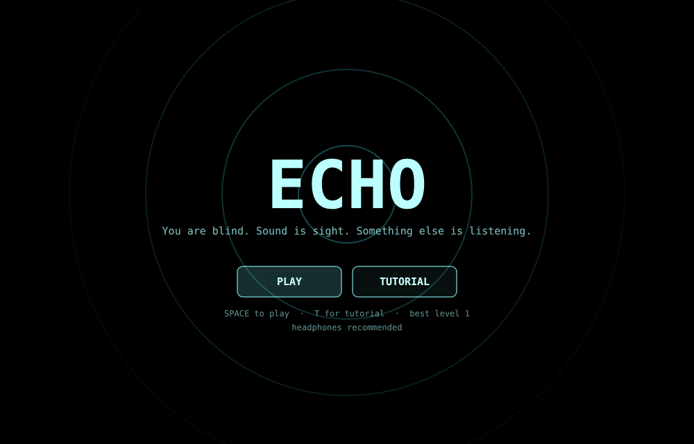
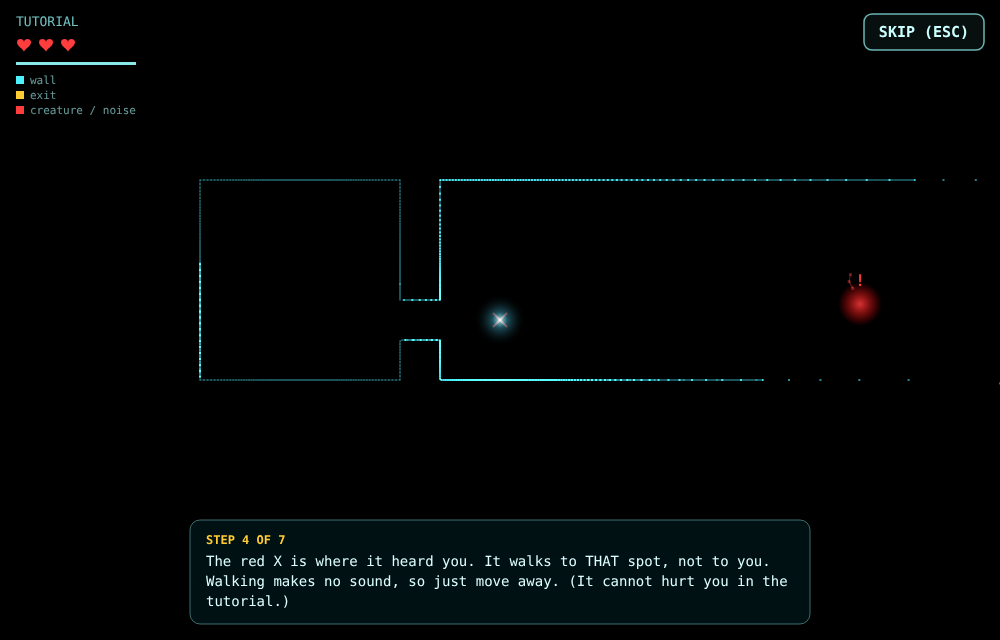

# ECHO

**You are blind. Sound is sight. Something else is listening.**



ECHO is a small stealth-horror game. The screen is pitch black, and the only way to see is to make a noise. Each sonar pulse spreads out, bounces off the walls and comes back as a fading outline of the maze. The creatures in the maze are blind too, and they hunt by sound.

**[Play it here](https://YOUR-USERNAME.github.io/echo/)**

It's all in one HTML file, with no engine, no libraries, and no image or audio files. The maze, the visuals and every sound are generated while you play.

## How to play

| Action | Keyboard | Touch |
|---|---|---|
| Move (silent) | WASD / arrow keys | Drag |
| Sonar pulse: see far, heard far | Space | Tap |
| Quiet click: see close, barely heard | E | Two-finger tap |
| Run: fast, but every step is a noise | Shift | Drag far |
| Skip tutorial | Esc | SKIP button |

Find the **gold** exit to reach the next level. Each level is bigger and has more creatures. You have **3 lives**. If you're caught, you restart the same maze. If you lose all three, it's game over and you go back to level 1.

New to the game? Pick **TUTORIAL** on the title screen for a seven-step guided run with a creature that can't hurt you.

## How the creatures work

The creatures follow a few simple rules, and the game shows you each one on screen:

1. **They can only hear.** If you're silent, they have no idea where you are. Walking is silent.
2. **They go to where the sound came from, not to you.** A red X marks the spot they heard. If you move away, they arrive at an empty place, search for a moment, then give up.
3. **You can see how far your noise travels.** Every noise sends out a dashed red ring. Any creature inside that ring hears it when the ring reaches it.
4. **You can see them react.** A creature that hears you glows red with a "!" and growls.
5. **You can see them coming.** Hunting creatures stomp, and you see red ripples and hear thuds. Your heartbeat speeds up and the screen edges turn red as they get close.
6. **You're told why you were caught**, for example "IT HEARD YOUR SONAR" or "IT HEARD YOU RUNNING".



## What's under the hood

- **Real-time echolocation.** Each pulse casts 320 rays through the grid using DDA traversal. Each echo only appears once sound would actually have reached that spot, so the world draws itself outward like a real wave.
- **Sound-driven AI.** Creatures use breadth-first search to path-find to the source of a noise, search when they get there, then go back to wandering.
- **Procedural levels.** Recursive-backtracker mazes with extra loops cut through for escape routes. Each maze is seeded, so after you're caught you replay the exact same layout.
- **Synthesised audio.** The sonar ping, clicks, footsteps, growls and heartbeat are all built live with the Web Audio API.
- About 700 lines of plain JavaScript and Canvas 2D.

## The code, explained

[`docs/ECHO-code-explained.pdf`](docs/ECHO-code-explained.pdf) walks through **every line** of `index.html` in plain language. Its line numbers match the file, so you can read the two side by side.

## Run it locally

Download `index.html` and open it in any modern browser. Nothing needs installing.

## Publish on GitHub Pages

1. Push this folder to a new repository (for example `echo`).
2. In the repository, go to **Settings → Pages** and set the source to the `main` branch, `/ (root)` folder.
3. After a minute or so, the game will be live at `https://YOUR-USERNAME.github.io/echo/`. Then replace the link at the top of this README with yours.

## Project files

```
index.html                     the whole game
docs/ECHO-code-explained.pdf   line-by-line guide to the code
docs/*.png                     screenshots used in this README
README.md                      this file
LICENSE                        MIT licence
CREDITS.md                     who made what
.gitattributes                 line-ending and language settings for Git and GitHub
```

## Licence

Copyright (c) 2026 Praise Adejubu. All rights reserved.
